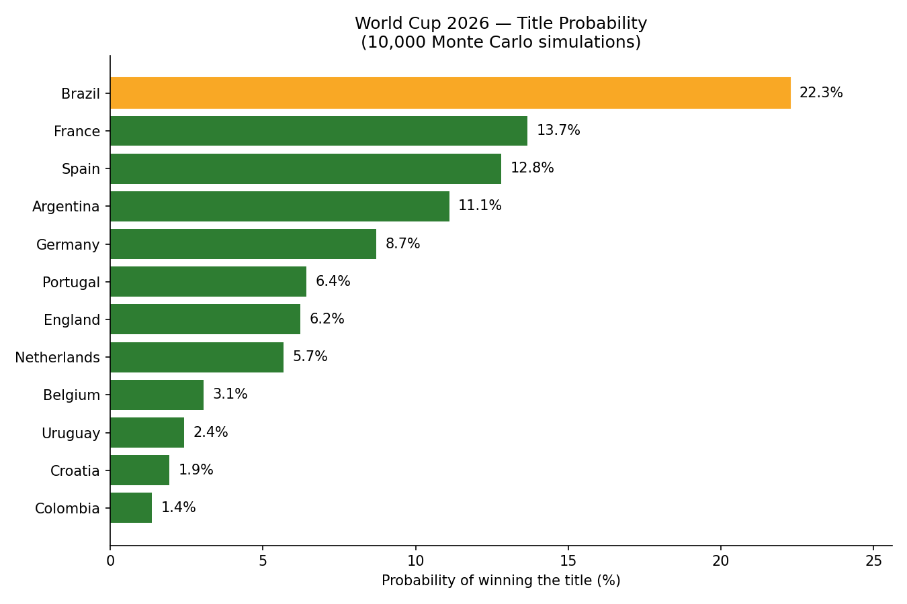

# World Cup 2026 Winner Prediction ⚽

> **Just for fun!** This is a personal side project, not a serious forecast.
> The ratings and team data are rough estimates, the model is deliberately
> simple, and the World Cup will do whatever it wants. Please don't bet on it. 😄

Who wins the 2026 World Cup? This project trains a small model on past
World Cup matches, then plays out the whole 48-team tournament **10,000 times**
to see how often each team lifts the trophy.



## The prediction

| Rank | Team | Chance of winning |
|---|---|---|
| 1 | 🇧🇷 Brazil | 22.3% |
| 2 | 🇫🇷 France | 13.7% |
| 3 | 🇪🇸 Spain | 12.8% |
| 4 | 🇦🇷 Argentina | 11.1% |
| 5 | 🇩🇪 Germany | 8.7% |
| 6 | 🇵🇹 Portugal | 6.4% |
| 7 | 🏴󠁧󠁢󠁥󠁮󠁧󠁿 England | 6.2% |
| 8 | 🇳🇱 Netherlands | 5.7% |
| 9 | 🇧🇪 Belgium | 3.1% |
| 10 | 🇺🇾 Uruguay | 2.4% |

Even the favourite wins the title only about 1 time in 5. Knockout football is
chaotic, and that's half the fun.

## How it works

1. **Learn from history:** a logistic regression is trained on 117 past World
   Cup matches (1930–2022). It learns how a difference in team strength (Elo
   rating) turns into win, draw or loss chances.
2. **Make it fair:** each match is scored from both teams' points of view and
   averaged, so it doesn't matter which team is listed first.
3. **Simulate the tournament:** with the 2026 format, 12 groups of 4 play a
   round-robin. Group winners, runners-up and the 8 best third-placed teams go
   to a Round of 32, then knockouts down to a single winner. A knockout draw is
   settled by a shootout that slightly favours the stronger team.
4. **Repeat 10,000 times:** count how often each team wins and turn that into a
   percentage. The random seed is fixed, so you get the same numbers every run.

## Files

| File | What's in it |
|---|---|
| `wc.py` | The whole pipeline: train, simulate, print results, draw the chart |
| `wc_matches_historical.csv` | Past World Cup matches with pre-match Elo ratings (training data) |
| `wc_prediction_features_2026.csv` | 2026 teams with Elo ratings and other team features |
| `wc_2026_groups.csv` | The 12 groups and the teams in each |
| `wc_2026_teams_snapshot.csv` | Background info on each team |
| `wc_2026_group_difficulty.csv` | How tough each team's group looks |
| `wc2026_chart.png` | The output chart |

## Run it yourself

```bash
pip install pandas numpy matplotlib scikit-learn
python wc.py
```

It prints the top 15 teams and saves the chart to `wc2026_chart.png`.

## Limitations (aka why this is just for fun)

- The model uses only one input: the Elo rating difference. Form, injuries,
  home advantage and the actual bracket path are ignored.
- The Elo ratings and team details are rough estimates, not official data.
- The knockout bracket is drawn randomly, not from FIFA's real draw.
- The training set is small, with only 117 matches.

Feel free to fork it and argue with my numbers!
